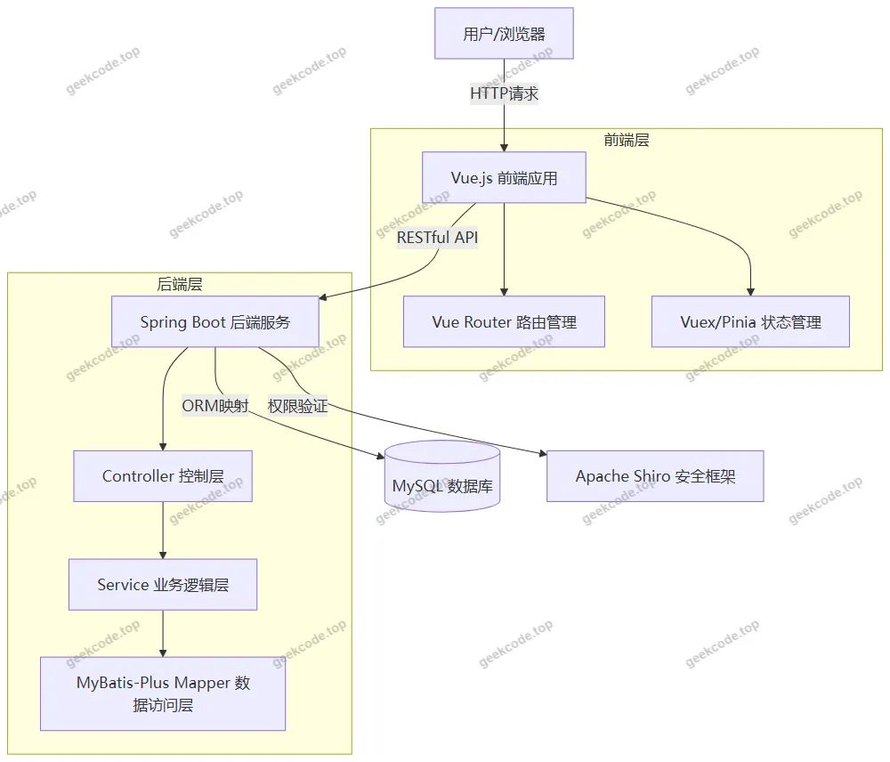
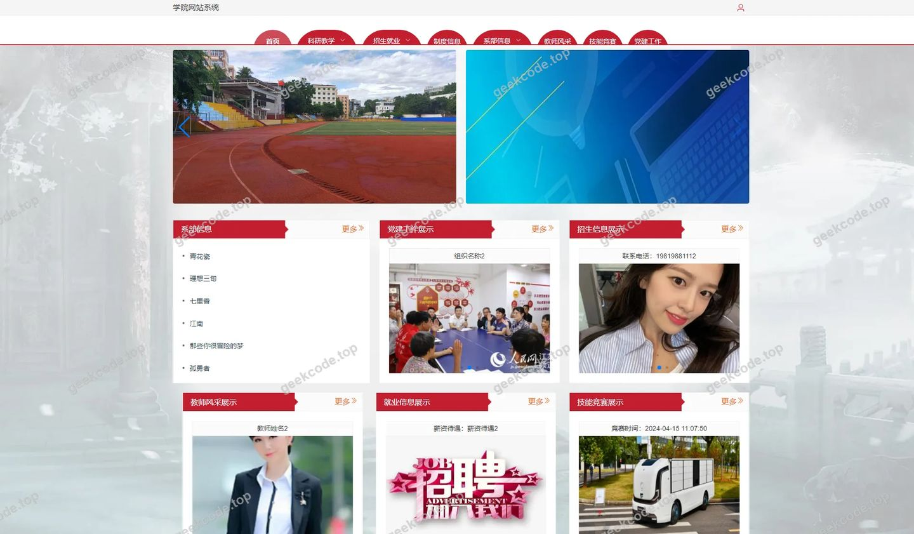
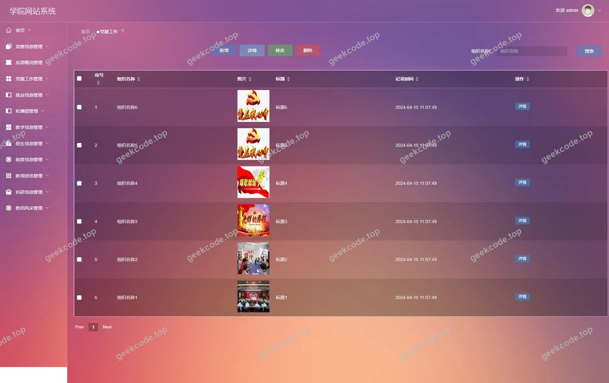
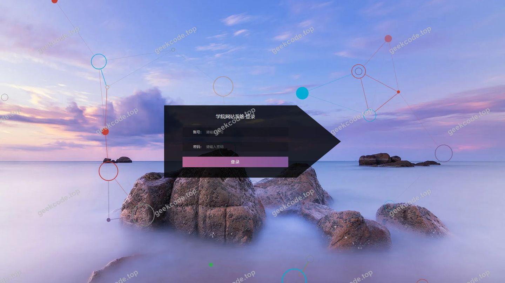
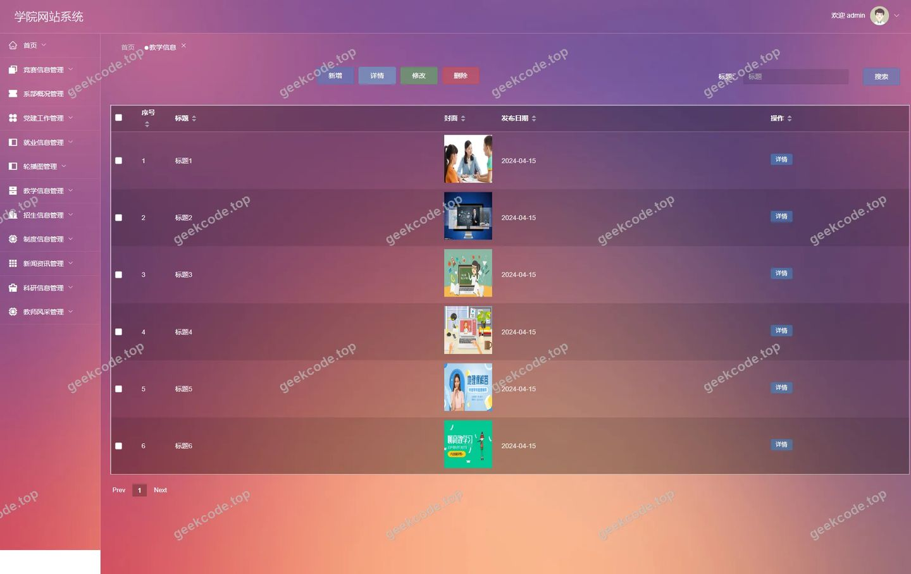
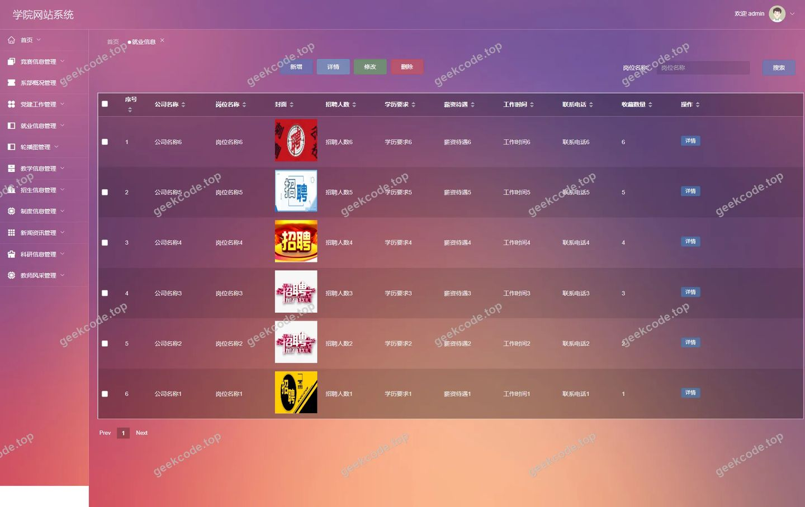
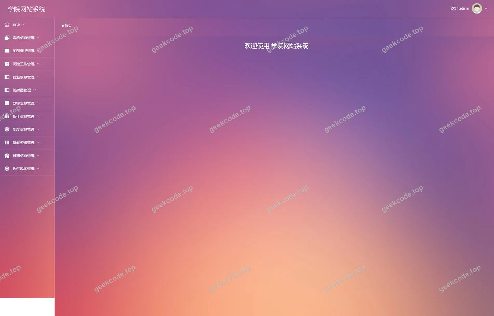
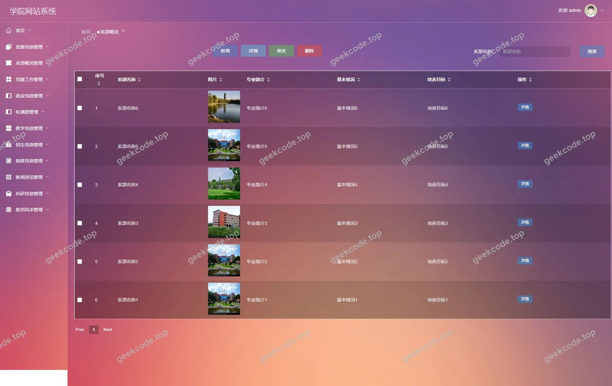
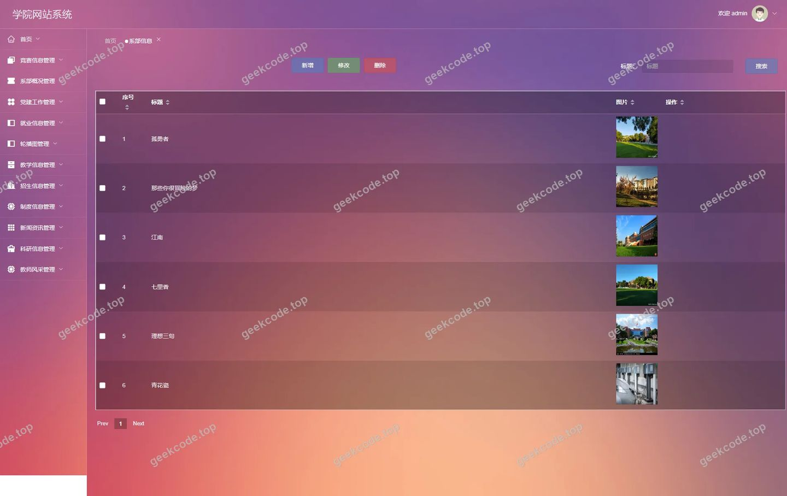
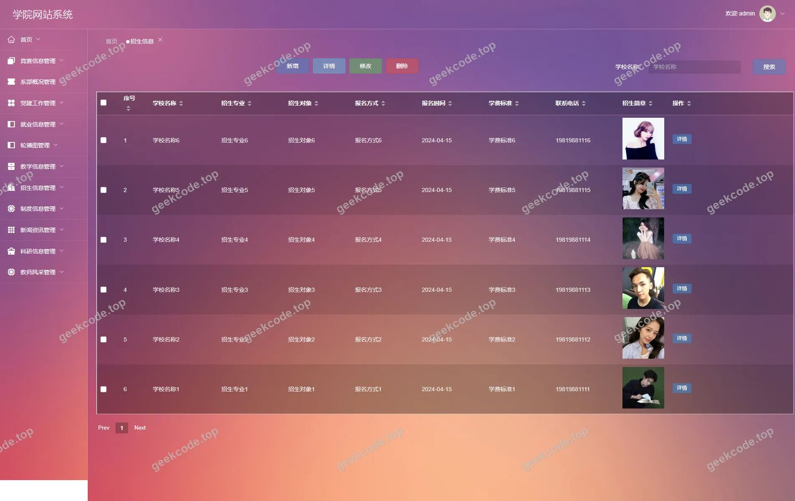

# [springboot]基于SpringBoot vue的学院网站系统

> 🎓 **计算机毕业设计 · [springboot]基于SpringBoot vue的学院网站系统**
>
> 本仓库只放**项目介绍 + 运行截图**（截图是站点带水印的原图，存在仓库 `images/` 里）。
>
> 👉 **完整可运行源码 / 数据库脚本 / 部署文档：[点我获取](https://geekcode.top/archives/springboot-%E5%9F%BA%E4%BA%8ESpringBoot-vue%E7%9A%84%E5%AD%A6%E9%99%A2%E7%BD%91%E7%AB%99%E7%B3%BB%E7%BB%9F?utm_source=github)**
>
> 💬 咨询微信：**ir9372**　|　🌐 更多项目：[极客代码 geekcode.top](https://geekcode.top/?utm_source=github)
>
> 📌 项目详情页：<https://geekcode.top/archives/springboot-%E5%9F%BA%E4%BA%8ESpringBoot-vue%E7%9A%84%E5%AD%A6%E9%99%A2%E7%BD%91%E7%AB%99%E7%B3%BB%E7%BB%9F?utm_source=github>

<table><td width="230" align="center"> <b>扫码加微信 ir9372</b></td><td valign="middle">📦 源码 = 项目介绍 + 全部运行截图 + 数据库 + 部署文档 👉 点上方任意截图，直接跳到 <b>极客代码 geekcode.top</b> 详情页</td></table>

---

<h1>[springboot]基于SpringBoot vue的学院网站系统</h1>
<h2>项目概述</h2>

本项目旨在构建一个基于 Spring Boot 和 Vue.js 的学院网站系统，实现学院信息的数字化管理与展示。系统采用前后端分离架构，核心功能涵盖教学信息、招生政策、就业动态、党建工作、系部概况、科研资讯及技能竞赛等多维度的内容发布与管理。该项目主要面向高校行政管理人员与普通师生用户。管理员通过后台对各类信息进行增删改查操作，确保内容的时效性与准确性；普通用户通过前台浏览学院最新动态、查询具体资讯详情。技术架构上，后端依托 Spring Boot 提供高效稳定的 RESTful API 服务，集成 MyBatis-Plus 简化数据持久层开发，并使用 Apache Shiro 进行安全认证与授权控制；前端采用 Vue.js 框架构建响应式界面，提升用户体验。该系统有效解决了传统学院信息发布渠道分散、管理效率低下的问题，为学院信息化建设提供了统一、规范的管理平台。

<h2>技术架构</h2>
<h3>1. 整体架构设计</h3>

本系统采用经典的前后端分离架构模式。前端负责页面渲染、用户交互及路由跳转，后端负责业务逻辑处理、数据访问及安全校验。两者通过 HTTP/HTTPS 协议以 JSON 格式进行数据交换。

<h3>2. 核心技术选型理由</h3>
<ul>
<li><strong>Spring Boot</strong>: 作为后端基础框架，其“约定优于配置”的理念极大地减少了样板代码，内置 Tomcat 容器便于快速部署，且拥有庞大的生态系统支持。</li>
<li><strong>MyBatis-Plus</strong>: 在 MyBatis 基础上进行了增强，提供了通用的 CRUD 接口和条件构造器，显著提升了单表操作的开发效率，同时保留了灵活编写复杂 SQL 的能力。</li>
<li><strong>Apache Shiro</strong>: 相比 Spring Security，Shiro 更轻量级且易于上手，能够清晰地处理身份认证、授权、加密和会话管理，适合中小型系统的权限控制需求。</li>
<li><strong>Vue.js</strong>: 渐进式 JavaScript 框架，组件化开发模式使得 UI 复用率高，双向数据绑定机制简化了视图更新逻辑，配合 Element UI 等组件库可快速搭建美观的管理界面。</li>
</ul>
<h3>3. 数据库设计要点</h3>

系统数据主要围绕“资讯类”实体展开，包括但不限于新闻、教学信息、招生信息等。所有业务模块均遵循统一的字段设计规范（如标题、内容、发布时间、作者、封面图等），并通过主键 ID 进行唯一标识。数据存储于 MySQL 数据库中，利用索引优化高频查询场景（如按时间排序、分类筛选）。

<h2>功能模块</h2>

根据源码路由配置及截图功能列表，系统分为前台用户端和后台管理端两大模块。

<h3>1. 前台用户端</h3>

前台主要面向公众或校内师生，提供信息浏览与简单交互功能。

<ul>
<li><strong>首页展示 (<code>/index/newsList</code>)</strong>: 聚合展示最新发布的各类资讯，包括新闻、公告等，提供入口导航。</li>
<li><strong>系部概况 (<code>/index/xibugaikuangList</code>, <code>/index/xibugaikuangDetail</code>)</strong>: 展示学院各系部的介绍信息，支持查看详情。</li>
<li><strong>教学信息 (<code>/index/jiaoxuexinxiList</code>, <code>/index/jiaoxuexinxiDetail</code>)</strong>: 发布课程安排、教学改革动态等信息，支持详情页查看。</li>
<li><strong>科研信息 (<code>/index/keyanxinxiList</code>, <code>/index/keyanxinxiDetail</code>)</strong>: 展示科研成果、学术讲座、项目申报等内容。</li>
<li><strong>党建工作 (<code>/index/dangjiangongzuoList</code>, <code>/index/dangjiangongzuoDetail</code>)</strong>: 宣传党建活动、理论学习材料及组织生活记录。</li>
<li><strong>招生信息 (<code>/index/zhaoshengxinxiList</code>, <code>/index/zhaoshengxinxiDetail</code>)</strong>: 公布招生简章、录取结果、咨询问答等招生相关数据。</li>
<li><strong>教师风采 (<code>/index/jiaoshifengcaiList</code>, <code>/index/jiaoshifengcaiDetail</code>)</strong>: 展示优秀教师简介、获奖情况及教学心得。</li>
<li><strong>就业信息 (<code>/index/jiuyexinxiList</code>, <code>/index/jiuyexinxiDetail</code>)</strong>: 发布招聘会通知、就业指导政策、校友去向统计等。</li>
<li><strong>制度信息 (<code>/index/zhiduxinxiList</code>, <code>/index/zhiduxinxiDetail</code>)</strong>: 公示学校规章制度、学生管理条例等规范性文件。</li>
<li><strong>技能竞赛 (<code>/index/jinengjingsaiList</code>, <code>/index/jinengjingsaiDetail</code>)</strong>: 报道各类职业技能大赛的通知、赛程及获奖名单。</li>
<li><strong>收藏功能 (<code>/index/storeupList</code>)</strong>: 用户可以查看自己收藏的文章或信息列表。</li>
<li><strong>登录功能</strong>: 前台提供用户登录入口，用于访问个人中心或执行特定操作。</li>
</ul>
<h3>2. 后台管理端</h3>

后台面向管理员，提供全面的内容管理与系统配置功能。

<ul>
<li><strong>新闻管理 (<code>/news</code>)</strong>: 对全站通用新闻数据进行维护。</li>
<li><strong>党建工作管理 (<code>/dangjiangongzuo</code>)</strong>: 新增、编辑、删除、查询党建工作相关文章。</li>
<li><strong>教学信息管理 (<code>/jiaoxuexinxi</code>)</strong>: 维护教学相关的通知公告与资料。</li>
<li><strong>招生信息管理 (<code>/zhaoshengxinxi</code>)</strong>: 管理招生政策、计划及动态。</li>
<li><strong>系部概况管理 (<code>/xibugaikuang</code>)</strong>: 编辑各系部的简介与详细信息。</li>
<li><strong>就业信息管理 (<code>/jiuyexinxi</code>)</strong>: 发布和管理就业市场信息及指导文章。</li>
<li><strong>技能竞赛管理 (<code>/jinengjingsai</code>)</strong>: 录入竞赛通知、结果及相关新闻。</li>
<li><strong>制度信息管理 (<code>/zhiduxinxi</code>)</strong>: 维护学校各项规章制度的文本内容。</li>
<li><strong>教师风采管理 (<code>/jiaoshifengcai</code>)</strong>: 更新教师个人档案及风采展示内容。</li>
<li><strong>科研信息管理 (<code>/keyanxinxi</code>)</strong>: 管理科研项目、成果及学术交流信息。</li>
<li><strong>系统配置 (<code>/config</code>)</strong>: 设置网站的基本参数，如Logo、名称、版权信息等全局配置。</li>
<li><strong>后台登录页</strong>: 管理员身份认证入口。</li>
<li><strong>后台首页</strong>: 展示系统概览或快捷操作入口。</li>
</ul>
<h2>用户角色与权限</h2>

基于 Apache Shiro 的安全框架及前后端路由隔离设计，系统主要涉及两类用户角色：管理员和普通用户（访客/注册用户）。

<h3>1. 管理员 (Admin)</h3>
<ul>
<li><strong>权限描述</strong>: 拥有系统的最高控制权，负责所有业务数据的维护与系统配置。</li>
<li><strong>可访问功能模块</strong>:</li>
<li><strong>全部后台管理菜单</strong>: 包括新闻、党建工作、教学信息、招生信息、系部概况、就业信息、技能竞赛、制度信息、教师风采、科研信息的所有增删改查操作。</li>
<li><strong>系统配置</strong>: 修改网站全局参数。</li>
<li><strong>后台登录</strong>: 通过账号密码验证进入管理界面。</li>
<li><strong>后台首页</strong>: 查看管理控制台。</li>
</ul>
<h3>2. 普通用户 (User/Guest)</h3>
<ul>
<li><strong>权限描述</strong>: 主要进行信息的浏览与检索，部分功能可能涉及个人数据管理（如收藏）。</li>
<li><strong>可访问功能模块</strong>:</li>
<li><strong>前台首页</strong>: 浏览最新新闻列表。</li>
<li><strong>各类资讯列表与详情</strong>: 可以查看系部概况、教学信息、科研信息、党建工作、招生信息、教师风采、就业信息、制度信息、技能竞赛的具体内容。</li>
<li><strong>添加操作 (Add)</strong>: 根据路由 <code>/index/...Add</code> 的存在，普通用户在登录后可能具备向系统提交某些类型信息（如投稿、报名或反馈）的权限，具体取决于业务逻辑限制。</li>
<li><strong>收藏管理</strong>: 查看自己的收藏列表 (<code>/index/storeupList</code>)。</li>
<li><strong>前台登录</strong>: 进行身份认证以解锁个性化功能。</li>
</ul>

<em>(注：由于源码中未明确区分“教师”、“学生”等细分角色的独立权限组，上述权限划分基于标准的“管理员-普通用户”二元模型。)</em>

<h2>项目特色与创新点</h2>
<ol>
<li><strong>全维度学院信息聚合</strong>: 系统将原本分散在教学、招生、就业、党建、科研等多个部门的信息整合至统一平台，打破了信息孤岛，实现了“一站式”资讯获取，极大提升了信息传播的效率与覆盖面。</li>
<li><strong>模块化内容管理体系</strong>: 针对学院特有的业务场景（如“系部概况”、“教师风采”、“技能竞赛”），设计了专属的数据模型与管理界面。这种垂直领域的精细化设计比通用的 CMS 系统更贴合高校实际管理需求。</li>
<li><strong>前后端分离的高效协作</strong>: 采用 Vue + Spring Boot 的主流技术栈，前端专注于视图层的快速迭代与用户体验优化，后端专注于业务逻辑与数据安全。这种架构不仅提升了开发效率，还具备良好的扩展性，便于未来接入移动端 App 或微信小程序。</li>
<li><strong>基于 Shiro 的安全可控性</strong>: 引入 Apache Shiro 进行细粒度的权限控制，确保了后台管理数据的安全性，防止未授权访问。同时，前端的动态路由与后端的鉴权机制相结合，保障了系统在开放环境下的稳定运行。</li>
<li><strong>灵活的收藏与互动机制</strong>: 前台提供的收藏功能 (<code>storeupList</code>) 增强了用户粘性，允许用户对感兴趣的政策、新闻或个人风采进行标记，方便后续快速查阅，体现了以人为本的设计理念。</li>
</ol>
<h2>部署环境</h2>

为确保项目正常运行，需准备以下软件环境：

<ol>
<li><strong>Java 运行环境</strong>:</li>
</ol>
<ul>
<li>JDK 1.8 或更高版本（推荐 JDK 8 LTS）。</li>
<li>Maven 3.6+ 用于依赖管理和项目构建。</li>
</ul>
<ol start="2">
<li><strong>数据库</strong>:</li>
</ol>
<ul>
<li>MySQL 5.7 或 8.0 及以上版本。</li>
<li>需创建对应的数据库实例并导入初始化 SQL 脚本。</li>
</ul>
<ol start="3">
<li><strong>前端环境</strong>:</li>
</ol>
<ul>
<li>Node.js (建议 v12.x - v16.x 之间，以兼容常见的 Vue CLI 版本)。</li>
<li>npm 或 yarn 包管理器。</li>
</ul>
<ol start="4">
<li><strong>服务器/容器</strong>:</li>
</ol>
<ul>
<li>生产环境建议使用 Linux (CentOS 7+/Ubuntu 20.04+) 搭配 Nginx 进行静态资源托管及反向代理。</li>
<li>开发环境可直接使用 IDE (IntelliJ IDEA, VS Code) 启动后端服务和前端开发服务器。</li>
</ul>
<ol start="5">
<li><strong>其他工具</strong>:</li>
</ol>
<ul>
<li>Git 用于版本控制。</li>
<li>Postman 或 Browser DevTools 用于接口调试。</li>
</ul>
<h2>五、技术特性</h2>
<ul>
<li>前后端集成部署，前端资源打包至后端 static 目录</li>
<li>使用 MyBatis-Plus 简化数据访问层开发</li>
<li>集成 Shiro 权限框架实现角色权限控制</li>
</ul>
<h2>六、功能模块截图</h2>
<h3>前台用户端</h3>
<h4>前台-首页</h4>

<h4>前台-登录</h4>

<h3>后台管理端</h3>
<h4>后台-党建工作</h4>

<h4>后台-登录页</h4>

<h4>后台-教学信息</h4>

<h4>后台-就业信息</h4>

<h4>页面-首页</h4>

<h4>后台-系部概况</h4>

<h4>后台-系部信息</h4>

<h4>后台-招生信息</h4>

---

## 获取完整源码

| 项目 | 说明 |
| --- | --- |
| 项目名 | [springboot]基于SpringBoot vue的学院网站系统 |
| 运行截图 | 本文 11 张（站点带水印原图，仓库 `images/` 目录） |
| 完整源码 | [https://geekcode.top/archives/springboot-%E5%9F%BA%E4%BA%8ESpringBoot-vue%E7%9A%84%E5%AD%A6%E9%99%A2%E7%BD%91%E7%AB%99%E7%B3%BB%E7%BB%9F?utm_source=github](https://geekcode.top/archives/springboot-%E5%9F%BA%E4%BA%8ESpringBoot-vue%E7%9A%84%E5%AD%A6%E9%99%A2%E7%BD%91%E7%AB%99%E7%B3%BB%E7%BB%9F?utm_source=github) |
| 咨询微信 | **ir9372**（备注：jingpin-yuanma） |
| 更多项目 | [极客代码 geekcode.top](https://geekcode.top/?utm_source=github) |

> 需要源码、部署、改配置、跑不起来等问题，加微信 ir9372 沟通，说明项目名即可。
